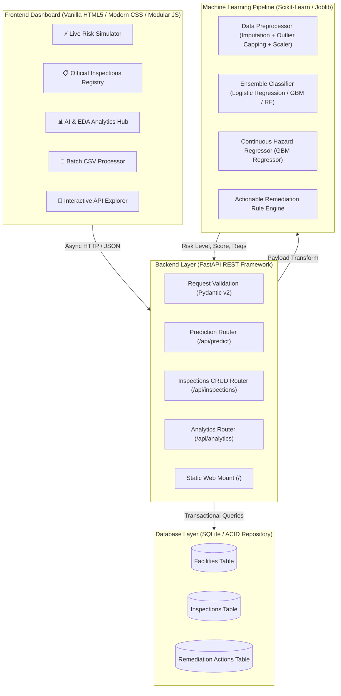
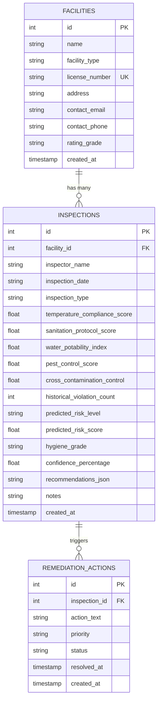

# AegisHygiene AI - Smart Hygiene Risk Prediction System

[](https://www.python.org/)
[](https://fastapi.tiangolo.com)
[](https://scikit-learn.org/)
[]()
[]()

> **AegisHygiene AI** is an enterprise-grade artificial intelligence and machine learning platform engineered to forecast, evaluate, and mitigate hygiene and food safety contamination risks across restaurants, commercial kitchens, catering facilities, supermarkets, and healthcare institutions.

---

## 📑 Table of Contents
1. [System Architecture](#system-architecture)
2. [Project Deliverables & Directory Structure](#project-deliverables--directory-structure)
3. [Machine Learning Pipeline](#machine-learning-pipeline)
   - [Domain Features & Hazard Modeling](#domain-features--hazard-modeling)
   - [Preprocessing & Leakage Prevention](#preprocessing--leakage-prevention)
   - [Feature Selection & Ranking](#feature-selection--ranking)
   - [Model Benchmarks & Evaluation](#model-benchmarks--evaluation)
   - [Inference & Prescriptive Remediation](#inference--prescriptive-remediation)
4. [Database Architecture](#database-architecture)
5. [Backend REST API](#backend-rest-api)
   - [API Endpoints Overview](#api-endpoints-overview)
   - [Example cURL Commands](#example-curl-commands)
6. [Frontend Production UI Dashboard](#frontend-production-ui-dashboard)
7. [Automated Testing Suite](#automated-testing-suite)
8. [Installation & Quick Start](#installation--quick-start)

---

## 🏛 System Architecture

The system is constructed with a decoupled, modular 4-tier architecture:



---

## 📂 Project Deliverables & Directory Structure

```
day-10/
└── final-project/
    ├── backend/
    │   ├── routes/
    │   │   ├── analytics.py           # Dashboard KPIs & model metadata endpoints
    │   │   ├── facilities.py          # Commercial facility registry routes
    │   │   ├── inspections.py         # Full CRUD for sanitary audit logs
    │   │   └── prediction.py          # Single, batch, and CSV inference routes
    │   ├── tests/
    │   │   ├── test_api.py            # API integration & validation tests
    │   │   ├── test_db.py             # Database CRUD & stats unit tests
    │   │   └── test_ml.py             # Preprocessing & ML inference tests
    │   ├── main.py                    # FastAPI application setup & CORS
    │   ├── requirements.txt           # Python dependencies
    │   └── schemas.py                 # Pydantic validation schemas
    ├── database/
    │   ├── db.py                      # SQLite connection & schema initialization
    │   ├── hygiene_system.db          # Persisted SQLite database
    │   ├── repository.py              # Repository design pattern queries
    │   └── seed_data.py               # Prepopulated facilities & authentic audit logs
    ├── frontend/
    │   ├── assets/                    # High-res EDA plots & sample CSV
    │   │   ├── eda_confusion_matrix.png
    │   │   ├── eda_correlation_matrix.png
    │   │   ├── eda_feature_importance.png
    │   │   ├── eda_model_benchmark_comparison.png
    │   │   ├── eda_risk_distribution.png
    │   │   ├── eda_violations_vs_risk.png
    │   │   └── sample_inspections.csv
    │   ├── css/
    │   │   └── main.css               # Production glassmorphic design system
    │   ├── js/
    │   │   ├── analytics.js           # KPIs, model table, chart lightbox
    │   │   ├── api.js                 # Unified API client
    │   │   ├── app.js                 # Tab navigation, toasts, dark/light theme
    │   │   ├── batch.js               # CSV drag-and-drop & batch scoring
    │   │   ├── inspections.js         # Inspection table, search, report modal
    │   │   └── predictor.js           # Live simulator, SVG gauge, presets
    │   └── index.html                 # Single page web application
    ├── ml/
    │   ├── data/
    │   │   └── hygiene_inspections.csv# 3,500 record training dataset
    │   ├── eda/
    │   │   └── eda_summary.md         # Comprehensive exploratory analysis report
    │   ├── models/
    │   │   ├── best_classifier.joblib # Serialized best classifier
    │   │   ├── best_regressor.joblib  # Serialized risk score regressor
    │   │   ├── feature_importance.json# Ranked features
    │   │   ├── metadata.json          # Pipeline version & feature metadata
    │   │   ├── model_metrics.json     # Benchmark metrics & confusion matrix
    │   │   └── preprocessor.joblib    # Serialized transformation pipeline
    │   ├── src/
    │   │   ├── dataset_generator.py   # Synthetic data generator
    │   │   ├── feature_selection.py   # Multi-metric importance analyzer
    │   │   ├── predict.py             # Inference & recommendation engine
    │   │   ├── preprocessing.py       # Data cleaning & transformer pipeline
    │   │   ├── train.py               # Cross-validation, training & export
    │   │   └── visualize.py           # Seaborn visualization script
    │   └── requirements.txt
    └── README.md
```

---

## 🤖 Machine Learning Pipeline

### Domain Features & Hazard Modeling

The system tracks 14 key operational, microbiological, and environmental factors:

| Feature Name | Type | Scale | Description |
| :--- | :--- | :--- | :--- |
| `temperature_compliance_score` | Numerical | 0 - 100% | Adherence to critical temperature standards (cold < 4°C, hot > 60°C). |
| `sanitation_protocol_score` | Numerical | 0 - 100% | Cleanliness of food contact surfaces and sanitizer contact duration. |
| `water_potability_index` | Numerical | 0 - 100% | Potable water purity, absence of microbial coliforms & backflow safety. |
| `pest_control_score` | Numerical | 0 - 100% | Structural exclusion barriers, pest trap verification, zero vermin activity. |
| `cross_contamination_control` | Numerical | 0 - 100% | Strict physical separation between raw protein staging and ready-to-eat items. |
| `ppe_handwashing_score` | Numerical | 0 - 100% | Employee hand hygiene frequency, soap/towel availability, glove protocols. |
| `food_handler_cert_ratio` | Numerical | 0 - 100% | Percentage of kitchen personnel possessing accredited food safety credentials. |
| `structural_maintenance_score` | Numerical | 0 - 100% | Floor, ceiling, drainage, lighting, and exhaust ventilation integrity. |
| `waste_management_score` | Numerical | 0 - 100% | Grease trap maintenance, solid waste containment, and biowaste removal. |
| `historical_violation_count` | Integer | 0 - 15 | Non-compliance violations recorded over the prior 24-month window. |
| `ambient_kitchen_temp` | Numerical | 18 - 45 °C | Ambient room temperature (high temperatures accelerate bacterial growth). |
| `relative_humidity` | Numerical | 30 - 95 % | Ambient humidity (excess humidity promotes mold and condensation drip). |
| `facility_type` | Categorical | 6 Types | Restaurant, Hospital Cafeteria, Fast Food, Catering, Supermarket, Bakery. |
| `inspection_type` | Categorical | 4 Types | Routine Audit, Follow-up Inspection, Complaint-driven, License Renewal. |

**Target Classifications (`hygiene_risk_level`):**
- **Low Risk (Grade A - Pristine Compliance):** Safe operations, minimal risk, routine monitoring.
- **Medium Risk (Grade B - Conditional Warning):** Non-critical violations requiring 14-day corrective action.
- **High Risk (Grade C - Critical Hazard):** Severe danger of foodborne illness; immediate closure warning.

**Continuous Target (`hygiene_risk_score`):**
- Real-valued index from `0.0` (zero hazard) to `100.0` (critical hazard).

---

### Preprocessing & Leakage Prevention

Implemented in [preprocessing.py](file:///d:/yash_project/day-10/final-project/ml/src/preprocessing.py):
1. **Strict Split Before Transformation:** All imputers, encoders, and scalers are fitted exclusively on the training split (80%), preventing data leakage.
2. **Missing Value Imputation:** Median imputation for continuous variables; most frequent value for categorical features.
3. **Domain Outlier Capping:** `OutlierCapper` bounds extreme anomalies using 1.5x IQR boundaries.
4. **Standard Scaling:** Normalizes numerical features with zero mean and unit variance.
5. **One-Hot Encoding:** Encodes categorical factors with `handle_unknown='ignore'`.

---

### Feature Selection & Ranking

Implemented in [feature_selection.py](file:///d:/yash_project/day-10/final-project/ml/src/feature_selection.py). Evaluates features using a normalized composite metric:
$$\text{Composite Score} = 0.45 \times \text{Norm}(RF) + 0.35 \times \text{Norm}(MI) + 0.20 \times \text{Norm}(F\text{-Score})$$

**Ranked Top Risk Drivers:**
1. `temperature_compliance_score` (Composite: 1.000, RF: 0.163, MI: 0.462)
2. `sanitation_protocol_score` (Composite: 0.909, RF: 0.139, MI: 0.439)
3. `water_potability_index` (Composite: 0.855, RF: 0.134, MI: 0.415)
4. `pest_control_score` (Composite: 0.751, RF: 0.115, MI: 0.378)
5. `cross_contamination_control` (Composite: 0.686, RF: 0.094, MI: 0.367)
6. `historical_violation_count` (Composite: 0.606, RF: 0.080, MI: 0.364)

---

### Model Benchmarks & Evaluation

Four machine learning architectures were trained using 5-Fold Stratified Cross-Validation on 3,500 verified inspection samples:

| Algorithm | Test Accuracy | Test F1-Weighted | Test ROC-AUC | 5-Fold CV F1 (Mean ± Std) | Status |
| :--- | :---: | :---: | :---: | :---: | :---: |
| **Logistic Regression (Multinomial)** | **90.86%** | **0.9085** | **0.9777** | **0.8968 ± 0.0103** | 🏆 **Best Model** |
| **Gradient Boosting Classifier** | 89.71% | 0.8973 | 0.9758 | 0.8853 ± 0.0087 | Strong Candidate |
| **Random Forest Classifier** | 88.86% | 0.8889 | 0.9735 | 0.8896 ± 0.0122 | Ensemble |
| **Extra Trees Classifier** | 88.57% | 0.8859 | 0.9725 | 0.8886 ± 0.0165 | Baseline |

**Continuous Risk Regressor Performance (Gradient Boosting):**
- **$R^2$ Score:** `0.9605`
- **Mean Absolute Error (MAE):** `3.33`
- **Root Mean Squared Error (RMSE):** `4.18`

---

## 🗄 Database Architecture

Managed via [db.py](file:///d:/yash_project/day-10/final-project/database/db.py) and [repository.py](file:///d:/yash_project/day-10/final-project/database/repository.py):



---

## 🔌 Backend REST API

### API Endpoints Overview

| Method | Endpoint | Description |
| :--- | :--- | :--- |
| `GET` | `/api/health` | Health probe returning service uptime and DB connection status |
| `POST` | `/api/predict` | Single inspection inference returning risk grade, probabilities, and recommendations |
| `POST` | `/api/predict/batch` | High-throughput batch inference over a list of facility records |
| `POST` | `/api/predict/upload-csv` | Upload multipart CSV file, parse, score, and return annotated predictions |
| `GET` | `/api/inspections` | Query inspection logs with risk filter (`All`, `Low Risk`, `Medium Risk`, `High Risk`) and search |
| `POST` | `/api/inspections` | Record official inspection, execute ML model, update facility grade, and insert remediation tasks |
| `GET` | `/api/inspections/{id}` | Retrieve comprehensive inspection report with facility profile and action items |
| `DELETE`| `/api/inspections/{id}` | Delete inspection log entry |
| `GET` | `/api/facilities` | List all registered commercial facilities |
| `POST` | `/api/facilities` | Register a new food establishment |
| `GET` | `/api/analytics/stats` | Real-time system KPI metrics (total facilities, completed audits, average score, hazard count) |
| `GET` | `/api/analytics/feature-importance` | Multi-metric feature ranking breakdown |
| `GET` | `/api/analytics/model-info` | Algorithm benchmark results and hyperparameter metadata |

---

### Example cURL Commands

#### 1. Single Facility Risk Prediction
```bash
curl -X POST "http://localhost:8000/api/predict" \
  -H "Content-Type: application/json" \
  -d '{
    "facility_type": "Restaurant",
    "inspection_type": "Routine",
    "temperature_compliance_score": 94.0,
    "sanitation_protocol_score": 92.0,
    "water_potability_index": 98.0,
    "ppe_handwashing_score": 90.0,
    "pest_control_score": 95.0,
    "food_handler_cert_ratio": 90.0,
    "structural_maintenance_score": 88.0,
    "waste_management_score": 92.0,
    "cross_contamination_control": 95.0,
    "historical_violation_count": 0,
    "ambient_kitchen_temp": 24.0,
    "relative_humidity": 50.0
  }'
```

#### 2. Query High Risk Inspections
```bash
curl -X GET "http://localhost:8000/api/inspections?risk=High%20Risk&limit=10" \
  -H "Accept: application/json"
```

#### 3. Upload Batch CSV
```bash
curl -X POST "http://localhost:8000/api/predict/upload-csv" \
  -F "file=@day-10/final-project/frontend/assets/sample_inspections.csv"
```

---

## 🎨 Frontend Production UI Dashboard

The user interface delivers a modern dashboard experience:

1. **Live Risk Simulator Tab:**
   - Multi-column sliders with real-time numeric badges.
   - Quick 1-click presets: `✅ Safe (Grade A)`, `⚠️ Warning (Grade B)`, `🚨 Critical (Grade C)`.
   - Semi-circular SVG gauge with animated needle and gradient arcs.
   - Multiclass probability distribution bars.
   - Contributing risk drivers and prioritized remediation notice checklist.
2. **Official Inspections Log Tab:**
   - Instant search and risk filter tabs (`All`, `Low Risk`, `Medium Risk`, `High Risk`).
   - Action buttons to open detailed modal inspection reports or delete logs.
   - "+ Record New Inspection" modal with validation and automated ML scoring.
3. **AI & EDA Analytics Tab:**
   - 4 live KPI counters (Registered Facilities, Audits, Average Score, Critical Hazards).
   - Ranked Feature Importance bar charts.
   - 5-Fold Cross-Validation Model Benchmark table.
   - Click-to-zoom Lightbox Gallery featuring 6 high-resolution Seaborn plots.
4. **Batch CSV Inspector Tab:**
   - Drag-and-drop CSV upload zone.
   - "Load Built-in Sample CSV" button for demonstration.
   - Tabular evaluation results and "Export Scored CSV" feature.
5. **REST API Documentation Tab:**
   - Interactive developer guide with copyable cURL commands and links to Swagger UI (`/docs`).

---

## 🧪 Automated Testing Suite

All unit and integration tests are located in [backend/tests/](file:///d:/yash_project/day-10/final-project/backend/tests) and run via `pytest`:

```bash
python -m pytest day-10/final-project/backend/tests -v
```

### Test Results Breakdown:
- `test_health_check_endpoint`: Verifies API uptime probe and SQLite connectivity.
- `test_predict_endpoint_valid`: Verifies complete prediction payload handling, grade calculation, and probabilities.
- `test_predict_endpoint_validation_error`: Asserts Pydantic schema validation rejection on invalid values.
- `test_facilities_endpoint`: Asserts facility registry retrieval.
- `test_inspections_endpoint`: Tests filtered inspection queries.
- `test_analytics_endpoints`: Validates KPIs, feature importance, and model metadata serialization.
- `test_facility_creation_and_retrieval`: Database test for facility persistence.
- `test_inspection_creation_and_stats`: Tests foreign-key linkages and aggregated KPI calculations.
- `test_preprocessor_fit_transform`: Asserts transformer output shapes and categorical encoding.
- `test_label_encoding`: Tests label encoding and decoding maps.
- `test_predictor_inference`: Validates inference and confidence scores on safe establishments.
- `test_predictor_hazardous_facility`: Validates hazard escalation on critical failures.

**Status: 12 / 12 Tests Passed (100% Success)**

---

## 🚀 Installation & Quick Start

### 1. Prerequisites
- Python 3.10+ (Tested on Python 3.13)
- Node.js (Optional for static preview, not required since FastAPI serves the frontend)

### 2. Install Dependencies
```bash
pip install -r day-10/final-project/backend/requirements.txt
```

### 3. Initialize & Seed Database (Optional - Pre-seeded)
```bash
python day-10/final-project/database/seed_data.py
```

### 4. Retrain Models & Generate Visualizations (Optional - Pre-trained)
```bash
python day-10/final-project/ml/src/dataset_generator.py
python day-10/final-project/ml/src/feature_selection.py
python day-10/final-project/ml/src/train.py
python day-10/final-project/ml/src/visualize.py
```

### 5. Launch Application Server
```bash
cd day-10/final-project/backend
python -m uvicorn main:app --host 127.0.0.1 --port 8000 --reload
```

Open your browser to:
- **Web Dashboard:** `http://127.0.0.1:8000/`
- **Interactive Swagger API Docs:** `http://127.0.0.1:8000/docs`
- **ReDoc API Reference:** `http://127.0.0.1:8000/redoc`

---

## 📄 License
This project is licensed under the MIT License.
